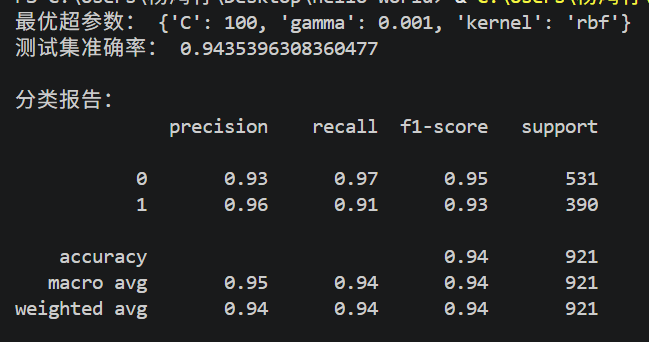
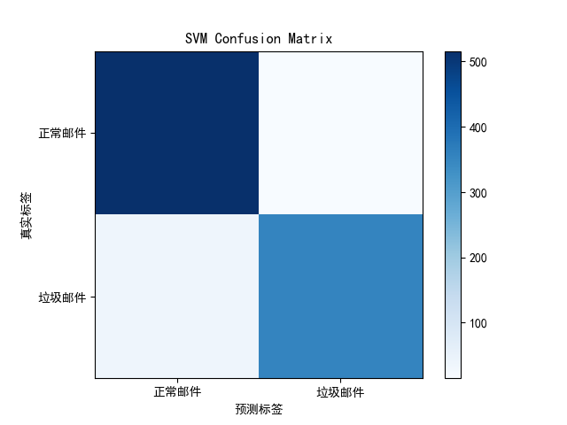

SVM支持向量机分类实验

实验目的
使用课件中的分类算法SVM（支持向量机），在Spambase垃圾邮件数据集上完成二分类任务，利用网格搜索寻找最优超参数，评估分类模型性能。

数据集说明

数据集采用Spambase垃圾邮件数据集，与Kaggle平台的spambase dataset完全一致，共4601条样本，57个特征。目标标签为二分类：0代表正常邮件，1代表垃圾邮件。

实验过程
1. 加载数据集，提取特征与标签。
2. 对特征进行标准化处理。SVM对特征量纲敏感，标准化是必要预处理步骤。
3. 按照8:2比例划分训练集与测试集。
4. 使用5折交叉验证网格搜索，遍历超参数C、gamma，选择RBF核函数，寻找最优模型参数。
5. 使用最优SVM模型在测试集上预测，计算准确率、分类报告，绘制混淆矩阵可视化分类结果。

实验结果

最优超参数：C=100，gamma=0.001，kernel=rbf
测试集准确率：94.36%
分类指标：
正常邮件(0)：精确率0.93，召回率0.97，F1值0.95
垃圾邮件(1)：精确率0.96，召回率0.91，F1值0.93
混淆矩阵直观展示了模型区分正常邮件与垃圾邮件的预测正误情况

结果分析

SVM采用RBF核函数，将原始高维特征映射到高维空间，寻找最优分隔超平面，实现二分类。通过网格搜索+5折交叉验证，选出泛化能力最优的C与gamma。模型整体准确率94.36%，分类效果优秀。

正常邮件召回率0.97，说明模型很少把正常邮件误判为垃圾邮件；垃圾邮件精确率0.96，说明预测为垃圾邮件的样本里绝大部分确实是垃圾邮件。

结论

SVM是经典的监督学习分类算法，在这份高维邮件特征数据集上拥有优秀的二分类效果。特征标准化是SVM建模必不可少的预处理步骤，会极大影响模型性能。

附图

终端运行结果

混淆矩阵

