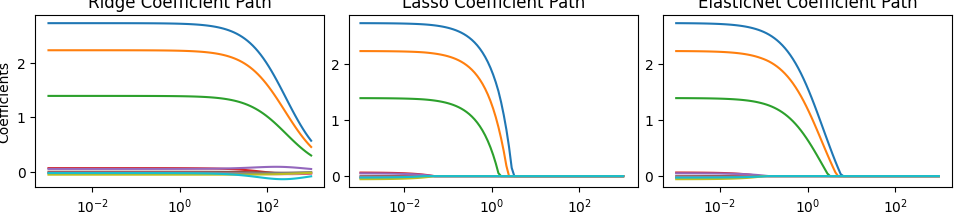

作业1：证明正交设计下 

$\boldsymbol{\hat\beta}_{Ridge}=\frac{1}{1+\lambda}\hat\beta_{OLS}$

已知

正交设计：$X^TX = I$（$I$ 是单位矩阵）
岭回归的闭式解公式：
$$
\hat\beta_{Ridge}=(X^TX+\lambda I)^{-1}X^Ty
$$
普通最小二乘OLS闭式解：
$$
\hat\beta_{OLS}=(X^TX)^{-1}X^Ty
$$

证明：

把正交条件 $X^TX=I$ 代入岭回归公式：
$$
\begin{align*}
\hat\beta_{Ridge}&=(X^TX+\lambda I)^{-1}X^Ty \\
&=(I+\lambda I)^{-1}X^Ty \\
&=\big((1+\lambda)I\big)^{-1}X^Ty \\
&=\frac{1}{1+\lambda}I\cdot X^Ty
\end{align*}
$$

再看OLS：
$$
\hat\beta_{OLS}=(X^TX)^{-1}X^Ty = I^{-1}X^Ty = X^Ty
$$

因此：
$$
\boldsymbol{\hat\beta}_{Ridge}=\frac{1}{1+\lambda}\hat\beta_{OLS}
$$
证明完毕。

正交设计下，岭回归就是直接把OLS所有系数统一缩小 $\frac{1}{1+\lambda}$ 倍。

---

作业3：为什么正则化前必须做Z-score标准化？不标准化会有什么后果？

正则化（Ridge、Lasso、弹性网）惩罚的是系数的大小，不是原始数据本身。

1. 如果各个特征量纲不一样（比如一个变量是收入，单位万元；一个变量是年龄，单位岁）：

    取值范围很大的变量，算出来的回归系数天然很小，几乎不会被惩罚；
    取值范围很小的变量，回归系数会很大，会被过度惩罚。
2. 惩罚效果完全被变量的单位绑架，对各个特征不公平。交叉验证选出来的最优λ就会失真。
3. 额外问题：如果没有中心化，截距项也会被错误地加上惩罚，而正则化本来是不惩罚截距的。

Z-score标准化的作用：把所有特征统一变换成均值为0、方差为1。全部变量放到同一个尺度上，保证正则惩罚对每一个特征公平。

故不标准化，正则惩罚不公平，模型结果不可靠。

---

作业4：

控制台输出：

Ridge | 最优λ=1.4175, 测试RMSE=0.99, 非零变量数:10

Lasso | 最优λ=0.0376, 测试RMSE=0.98, 非零变量数:6

ElasticNet | 最优λ=0.0123, 测试RMSE=0.98, 非零变量数:9

系数路径图

结果解读
1. Ridge（岭回归，L2正则）

随着λ增大，系数慢慢变小收缩，但是永远不会变成0。
本次实验10个变量全部保留，没有剔除任何特征。
特点：只能压缩系数，不能做变量筛选。

2. Lasso（套索回归，L1正则）

λ增大到一定程度，不重要特征的系数会直接压缩到0，自动删掉无用变量。
本次最优模型只保留6个变量，实现特征筛选。

3. ElasticNet（弹性网，L1+L2混合正则）

同时拥有L2和L1惩罚。既能压缩系数，也能把部分系数压缩到0。
稀疏能力介于Ridge和Lasso之间，本次保留9个变量。

1-SE法则含义：
不直接挑选交叉验证误差最小的λ，而是挑选在最小误差±1个标准误范围内，最大的λ。
λ越大，惩罚越强，模型变量越少、越稀疏。

核心思想：模型精度损失很小（不超过1个标准误）的前提下，优先选更简单、变量更少的模型，降低过拟合风险。

- Ridge：无法把系数压缩到0，就算用1-SE选出更大λ，变量数量依旧不变，不能得到稀疏模型。
- Lasso：非常适合1-SE准则。在预测误差几乎不变的情况下，可以进一步剔除多余特征，得到更精简的稀疏模型。
- ElasticNet：稀疏能力弱于Lasso，1-SE筛选后减少的变量数量一般少于Lasso。

小结：

Lasso和ElasticNet的测试RMSE略优于Ridge。Lasso可以自动筛选变量，用更少特征达到相近预测效果。
