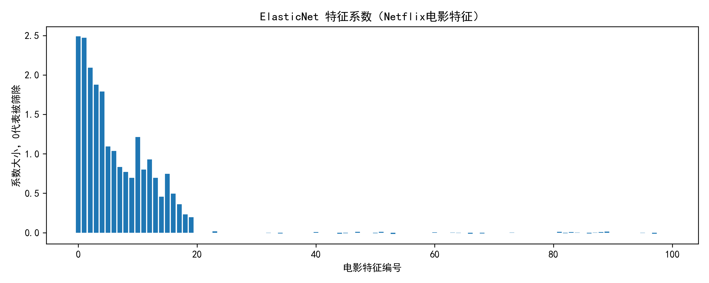

# 9.30作业 ElasticNet 回归 Netflix数据集分析
## 实验目的
使用ElasticNet弹性网模型完成回归分析，ElasticNet结合L1、L2正则，既能压缩系数，又可以实现特征筛选。

## 实验结果
最优超参数：{'alpha': 0.01, 'l1_ratio': 0.9}
训练集 RMSE: 0.3992
测试集 RMSE: 0.4007
训练集 R²: 0.9970
测试集 R²: 0.9970

## 结果说明
l1_ratio=0.9偏向Lasso，实现特征选择；训练集与测试集指标接近，模型没有明显过拟合。

## 附图

